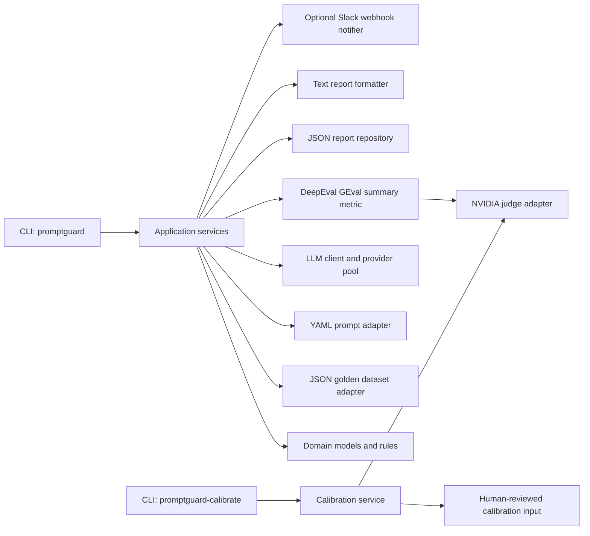
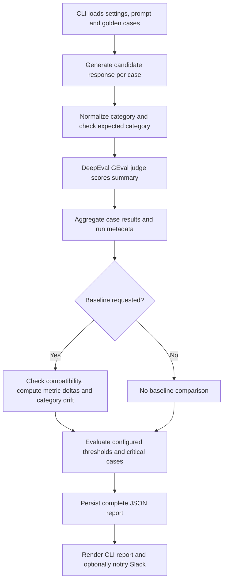
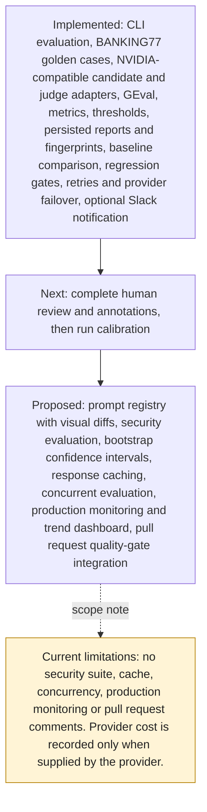

# PromptGuard

Production-oriented LLM evaluation and regression detection system.

## System architecture

The diagram shows components present in `src/promptguard/`. The judge is a
separate adapter and evaluation role; provider settings may point candidate
generation and judging at the same model or different models.



## Evaluation flow



## Roadmap and status

Statuses describe the current repository. “Proposed” items are not
implemented capabilities; calibration remains blocked until the human review
and annotation gates are complete.



`.github/workflows/evaluation.yml` runs tests, lint, type checks, and
evaluation quality gates on pushes and pull requests. It does not comment
on pull requests. Prompt YAML files are versioned inputs, not a
prompt registry or visual diff system. Calibration status and evidence are
tracked in `reports/execution-evidence/execution-summary.md`.

## CLI

```
promptguard [--prompt-version v1] [--baseline latest|RUN_ID] [--limit N]
            [--min-category-accuracy 0.8] [--min-summary-score 3.5]
            [--max-latency-ms 2000]
            [--max-category-accuracy-drop 0.05]
            [--max-summary-score-drop 0.4]
            [--max-category-accuracy-drop-pct 10]
            [--max-summary-score-drop-pct 15]
            [--runs-dir runs]
```

`--prompt-version` and `--baseline` values must be simple identifiers
containing only letters, digits, dots, hyphens, or underscores, and must
start with a letter or digit. Repository paths are resolved and constrained
to their configured directories. Threshold values must be finite; an infinite
latency threshold is rejected rather than disabling the latency gate.

Exit codes: `0` = PASS, `1` = FAIL, `2` = INCONCLUSIVE or a
configuration/provider/data error. A run is INCONCLUSIVE when no
thresholds are configured, when a configured drop threshold cannot be
evaluated because the baseline is missing or incompatible, when no cases
were evaluated, or when the case set or critical-case set differs from
the baseline. Absolute thresholds can pass without a baseline. All
configured thresholds are mandatory: every absolute threshold must pass,
and every drop threshold must be evaluable and pass. Any violation fails
the run; mixed absolute and drop policies never pass on a partial
evaluation. `--limit` must be at least `1`; an empty run can never satisfy
a quality gate.

Provider failures are reported as actionable, secret-free messages: time
outs point at `NVIDIA_REQUEST_TIMEOUT_SECONDS`, authentication failures
point at `NVIDIA_API_KEY` (the key value is never printed), rate limits
name the backoff path, and connection failures point at the network and
`NVIDIA_BASE_URL`. Known provider errors echo no provider payload; unknown
failures keep their diagnostic context with the configured key redacted.
All such failures exit `2`, distinct from a gate FAIL.

### Judge calibration

```
promptguard-calibrate --file calibration.json [--output report.json]
                      [--min-samples 20] [--max-mae 0.75]
                      [--min-pearson 0.6] [--min-within-one 0.8]
                      [--max-absolute-bias 0.5]
```

Calibration input must be an object with dataset metadata and an
`examples` list. Every example requires a human-reviewed score on the same
1-5 scale as the judge. The rubric version and content hash must match the
current rubric, so labels cannot silently survive a rubric change:

```json
{
  "metadata": {
    "version": "calibration-v1",
    "rubric_version": "v1",
    "rubric_sha256": "<current summary-quality rubric hash>"
  },
  "examples": [
    {
      "id": "case-1",
      "expected_summary": "Human reference summary",
      "actual_summary": "Candidate summary",
      "human_score": 4
    }
  ]
}
```

The command scores each candidate with the configured judge and reports
mean absolute error, RMSE, Pearson and Spearman correlation, exact and
within-one agreement, and mean bias. It also records the dataset version,
content hash, sample count, rubric identity, evaluator identity, and every
per-example human/judge score. High correlation alone cannot pass: the
MAE, within-one agreement, and absolute-bias limits are mandatory. Exit
codes are `0` when all calibration limits pass, `1` when they fail, and `2`
for configuration or provider errors. Do not use provisional or
model-generated labels as human ground truth.

Calibration data preparation is documented in
[`dataset/calibration/README.md`](dataset/calibration/README.md) and the
annotation protocol in
[`dataset/calibration/ANNOTATION_PROTOCOL.md`](dataset/calibration/ANNOTATION_PROTOCOL.md).
The v1 plan selects 100 unlabeled BANKING77 cases, two per prompt category,
and requires human-written references plus 20% double annotation. Current
status: the sample manifest is approved (the `card_pin` inclusion review is
complete, recorded in `v1/manifest_validation.json`), candidate outputs are
generated in `v1/candidate_outputs.json`, and the 120-row reviewer workbook
(`v1/annotation_workbook.csv`) is blank and awaiting human annotation.

Validate the workbook at any time; it exits `0` only when annotations are
complete and mechanically consistent with the recorded candidates:

```powershell
uv run python scripts/validate_annotation_workbook.py
```

For the v1 plan, run the calibration command with `--min-samples 100` only
after the workbook is fully annotated, the labels validate against
`v1/calibration_schema.json`, and no model-generated label has been treated
as human ground truth.

Reports are persisted as complete JSON runs under `runs/` and rendered
to the console. When a baseline is used, the comparison deltas are stored
on the report and rendered even when the gate passes. Every report carries
an `eval_config_hash` fingerprinting the prompt, dataset, model, test
cases, sampling configuration, and evaluator identity: judge provider and
model, endpoint, rubric version and content hash, and DeepEval version.
Changing any of those evaluator inputs invalidates prior baselines.
Gate thresholds are persisted separately and are deliberately excluded
from the fingerprint, so changing a release policy does not invalidate a
comparable baseline. A baseline without a fingerprint is INCONCLUSIVE
rather than silently accepted. Reports created before evaluator identity
was added remain loadable, but a legacy fingerprint cannot prove judge
identity and will not match a new run; that baseline is INCONCLUSIVE
rather than silently trusted.

Timestamps are normalized to UTC and must be timezone-aware. Reports with
naive, missing, or malformed timestamps are skipped when listing runs and
recorded in `skipped_runs`. Selecting `--baseline latest` refuses to fall
back to an older report when any persisted run file is invalid; the run is
INCONCLUSIVE and the skipped-file diagnostics are printed by the CLI.
Explicit baseline IDs still load their requested report. Aggregate accuracy,
score, latency, and token totals are
validated against the stored case results, and inconsistent evidence is
INCONCLUSIVE rather than trusted. Slack notification is enabled only when
`SLACK_WEBHOOK_URL` is set in `.env`; delivery failures are reported as
warnings and do not change the quality-gate decision.

The application retry policy is the only retry layer: SDK retries are
disabled. Transient transport failures (timeouts, connection errors, and
5xx responses) are retried up to three attempts per provider. Rate limits
(429) and credential rejections (401) are not retried in place: they fail
over immediately to the next provider in `PROVIDER_POOL`. When the last
provider is exhausted, the run fails with an actionable
`QuotaExceededError` and exit code 2. Transient failures also fail over
once per-provider retries are spent, unless the failing provider is the
only one configured, in which case the original error is raised.

Requests are throttled client-side: request starts are spaced at least
`NVIDIA_MIN_REQUEST_INTERVAL_SECONDS` apart (default `1.0`, 0-60 allowed),
shared per provider and across the candidate client and judge.

Fallback providers are configured as a JSON list in `PROVIDER_POOL`;
providers are tried in order:

```
PROVIDER_POOL=[{"name": "primary", "base_url": "https://integrate.api.nvidia.com/v1", "api_key": "nvapi-...", "model": "nvidia/nemotron-3-ultra-550b-a55b"}, {"name": "backup", "base_url": "https://openrouter.ai/api/v1", "api_key": "sk-or-...", "model": "meta-llama/llama-3.3-70b-instruct"}]
```

Without `PROVIDER_POOL`, the single `NVIDIA_*` provider is used and
behavior is unchanged. When a pool is configured, its composition (never
credentials) is recorded in `eval_config_hash` inputs, so runs with a
fallback pool and runs without one are not treated as comparable
baselines. A pool rotator is fresh per request: an exhausted primary
costs one fast 429 per call until its quota window resets, then the pool
returns to it automatically.
Requests time out after `NVIDIA_REQUEST_TIMEOUT_SECONDS` (default `30`,
allowed range 1-60). The default is informed by observed provider latency
(roughly 3.5-8 seconds per request in recent runs) with headroom for slow
outliers, while keeping three attempts well inside the run deadline.
The complete CLI evaluation is bounded by `EVALUATION_TIMEOUT_SECONDS`
(default `900`), so a stuck provider cannot outlive the CI job. Invalid
JSON, schema violations, blank required text, and empty model responses are
deterministic failures and are not retried. Non-finite or out-of-range judge
scores are rejected rather than clamped into a passing score.

Critical cases are marked in the golden dataset with `critical: true`
and a `critical_rationale`. Any critical-case failure fails the run even
when aggregate metrics and baseline comparisons pass.

The Docker build context is filtered by `.dockerignore`; local `.env`
files, VCS data, virtual environments, caches, runs, and reports are not
copied into the image. The runtime image installs the production dependency
set without the dev dependency group and runs as the unprivileged `appuser`.

Set `NVIDIA_TEMPERATURE` and `NVIDIA_SEED` in `.env` to make generation
and judging reproducible (both are optional).

## Quick demo

Prerequisites: `.env` containing `NVIDIA_API_KEY` and `NVIDIA_MODEL`.

Run the full 3-step demo (checks, evaluation with a passing gate, then a
failing gate):

```powershell
powershell -ExecutionPolicy Bypass -File scripts\run_demo.ps1
```

Or run the steps manually:

```powershell
# 1. Evaluate 10 golden cases against the most recent persisted run.
#    Exit 0 when the quality gate passes. The explicit 60-second override
#    adds headroom over the 30-second default for slow providers.
$env:NVIDIA_REQUEST_TIMEOUT_SECONDS = "60"
uv run promptguard --prompt-version v1 --limit 10 --baseline latest `
    --min-category-accuracy 0.7 --min-summary-score 3.0 --max-latency-ms 60000

# 2. The full report is printed and persisted under runs\<run-id>.json.

# 3. Force a gate failure: require 100% category accuracy against a model
#    scoring ~80%. Exit 1 proves the regression gate blocks the release.
uv run promptguard --prompt-version v1 --limit 10 --baseline latest `
    --min-category-accuracy 1.0
```

Each report records the run ID, UTC timestamp, model, prompt version,
dataset, token totals, and an `eval_config_hash` fingerprinting the prompt,
dataset, model, and judge configuration, so runs are reproducible and
baselines are comparable.

Reports also include multi-class classification metrics computed from the
per-case category evidence: per-class precision, recall, F1, and support;
macro and support-weighted aggregates; and the full confusion matrix.
Zero-denominator precision, recall, and F1 are reported as 0.0, never NaN.
These metrics are descriptive evidence and do not participate in quality
gates; gate decisions remain governed by the configured thresholds and
baseline comparisons. Wide confusion matrices (more than eight labels) are
persisted in the JSON report but omitted from console output.

Reports also include seeded percentile-bootstrap confidence intervals for
category accuracy (resampling per-case expected/predicted pairs) and for
the mean summary score (resampling per-case scores). Defaults are 2,000
resamples at 95% confidence with a fixed seed (`BOOTSTRAP_SEED`,
`BOOTSTRAP_RESAMPLES`, and `BOOTSTRAP_CONFIDENCE_LEVEL` environment
variables override them), so identical inputs reproduce identical
intervals. Intervals quantify sampling uncertainty under the resampling
scheme only: they do not prove the golden dataset represents production
traffic, and they do not establish judge agreement with human reviewers.
Empty runs have no intervals, and gates never consume these values.

When a baseline run is compared, reports also include paired per-case
analysis aligned by test case id (never by array position): the counts of
cases the candidate regressed on (baseline only correct), fixed
(candidate only correct), and agreed on, an exact McNemar p-value over
the discordant pairs, and a paired bootstrap interval for the mean
summary-score change (candidate minus baseline per case). Equal-accuracy
runs that fail on different cases are therefore distinguished. With zero
discordant cases the test is reported as uninformative rather than
claiming an effect; an interval containing zero does not establish a
direction. If the runs cannot be aligned reliably, the analysis is
reported as unavailable with a reason. Like the other statistics, paired
analysis is informational evidence: release gates, statuses, and exit
codes are unchanged.

## Development

```
uv run pytest
uv run ruff check src tests scripts
uv run mypy src
```

Test suites:

| Suite | Purpose |
|---|---|
| `tests/unit/` | Fast, isolated tests for each component |
| `tests/integration/` | End-to-end pipeline, persistence, notifications, and CLI wiring |
| `tests/evaluation/` | Evaluation semantics, normalization, drift, and quality-gate acceptance |
